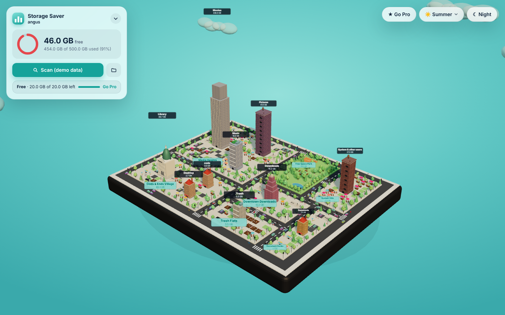
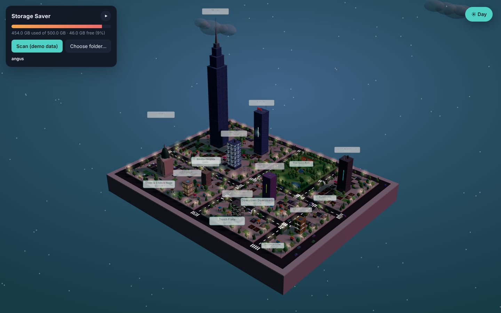
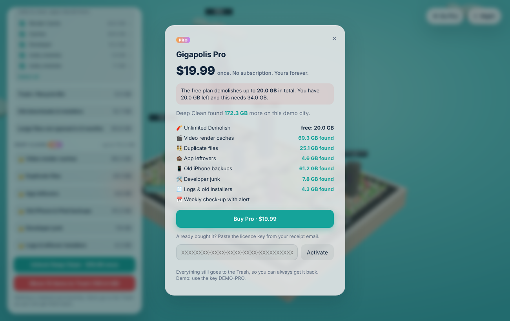

# Gigapolis

Keeps your computer's storage low. Your files become a 3D city: each category is a suburb (Media District, Cache Town, Downloads…), every folder or big file is a building whose height is its size, and free space is a park. Click a building for options, including **Demolish** (moves it to the Trash). A Safe clean panel finds caches, old downloads, trash and stale large files to clear in one go.




## Run it

```bash
npm install
npm start
```

Click **Scan my files** (scans your home folder) or **Choose folder…** for any other folder.

- **Drag** to orbit, **scroll** to zoom, **click** a building for Walk in / Show in Finder / Demolish, **double-click** the sky to go back up.
- Colours: orange = caches & temp, purple = downloads & installers, blue = video/photo/audio, green = apps, yellow = documents, grey = other/system, dark glass = free space.
- **☾ Night** (top right) switches to night: stars, lit windows, lamps, headlights and neon.
- **While scanning** the city is a construction site: roads laid, cranes swinging, road crews patching, and each top-level folder's building goes up the moment it has been measured.
- **Full Disk Access** (macOS): a one-time screen opens the exact System Settings switch so there are no per-folder pop-ups.
- **Performance** tab (the Power Station): live memory (with macOS memory pressure), processor load and a 2-minute graph, the heaviest apps by memory or processor (helpers grouped under their app), disk traffic, battery and heat. **Quit** asks first, and offers Force quit if the app doesn't close; macOS / Windows system processes never get a Quit button. Samples every 3 s only while the tab is open. Free.
- **Maintenance** tab (Public Works): one-click housekeeping. Mac: flush DNS, rebuild Launch Services ("Open With" menus), run maintenance scripts, free up memory, First Aid disk check, repair home folder permissions, rebuild Spotlight. Windows: flush DNS, reset the icon cache, open Disk Cleanup, check the disk, optimise the drive, repair system files (SFC). Jobs that need an administrator run together after one password / UAC prompt. Nothing deletes your files. Free.
- **Safe clean** lists what can go. Everything goes to the Trash / Recycle Bin, never a permanent delete.

## Browser demo

`npm run build:demo` writes `demo/index.html`, a single file that runs the same UI on sample data in any browser (no scanning or deleting).

## Install on a Mac

Download the latest `.dmg` from [Releases](https://github.com/angus-byte/storage-saver/releases) (`-arm64` for Apple silicon, otherwise the Intel one), open it and drag Gigapolis to Applications.

The build is signed with a Developer ID and notarised by Apple, so it opens like any other Mac app.

Builds come from the **Build Mac app** GitHub Action (run it by hand or push a `v*` tag). Locally on a Mac, `npm run dist` writes the `.dmg` to `dist/`.

## Layout

- `src/main/scanner.js` – folder walker, size aggregation, categories, cleanup suggestions (pure Node, tested).
- `src/main/main.js` – Electron window and the privileged actions (scan, reveal, move to Trash).
- `src/renderer/` – the UI: `app.js` (Three.js scene + panel), `treemap.js` (squarified layout), `mock.js` (demo data).
- `assets/models/*.glb` – hand-made landmark buildings (Applications = art deco tower, Documents = domed station, Downloads = apartment block, Movies + Photos = film soundstage, Music = neon guitar tower, Desktop = market square, App Data = classical library). After adding or changing one, run `node scripts/embed-models.js` (writes gzipped copies to `src/renderer/models/`) and map it to a category in `src/renderer/models.js`.

## Roadmap

1. Scanner + 3D view (done)
2. Safe clean: caches, trash, old downloads, stale large files (done)
3. Duplicate finder
4. Weekly background scan + low-space alert (done)
5. Menu bar / tray widget: free space, Safe Clean, low-space alert, keep running, open at login (done)
6. Cloud/external-drive offload for large stale media

## Free and Pro (Gigapolis Pro)

| | Free | Pro ($19.99 once) |
|---|---|---|
| Full scan + whole city | ✓ | ✓ |
| Street Sweep (Trash, old Downloads, caches, big stale files) | ✓ | ✓ |
| Demolish (move to Trash) | 20 GB a month | Unlimited |
| Deep Clean: render caches, duplicates, app leftovers, old iPhone backups, dev junk, logs/installers | see what's found | ✓ |
| Weekly check-up with alert | | ✓ |
| Performance tab: live memory / processor monitor, quit heavy apps | ✓ | ✓ |
| Maintenance tab: DNS, Spotlight / icon cache, disk check, system scripts | ✓ | ✓ |

Pro is unlocked with a **Lemon Squeezy licence key** (no account or login). Checkout link, store id (513897) and product id (1496849) live in `src/main/config.js`; env vars `GIGAPOLIS_CHECKOUT_URL` / `GIGAPOLIS_STORE_ID` / `GIGAPOLIS_PRODUCT_ID` override them. The key is checked online on activation and every few days after; Pro keeps working offline for 30 days. The free allowance is enforced in the main process. For development, `GIGAPOLIS_PRO=1 npm start` forces Pro (unpackaged builds only). In the browser demo the key `DEMO-PRO` unlocks Pro.


